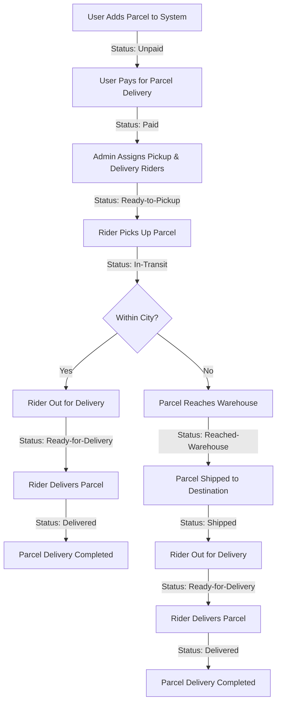

# Zap Shift – Parcel Delivery Management System

**Zap Shift** is a parcel delivery management system designed to simplify and streamline parcel booking, payment, tracking, and delivery operations across Bangladesh.

The platform provides dedicated functionality for customers, administrators, and delivery riders, ensuring an organized delivery process from parcel booking to successful delivery.

## 👥 User Roles & Responsibilities

The system supports three types of users, each with dedicated responsibilities and access.

| Role      | Responsibilities                                                                                  | Benefits                                                                     |
| --------- | ------------------------------------------------------------------------------------------------- | ---------------------------------------------------------------------------- |
| **User**  | Book parcels, pay delivery charges, track parcel status, and review services.                     | Real-time parcel tracking and feedback opportunities.                        |
| **Admin** | Assign pickup and delivery riders, manage routes, oversee warehouses, and monitor operations.     | Complete system control and operational oversight.                           |
| **Rider** | Collect and deliver parcels, update delivery status, verify OTPs, and handle warehouse transfers. | 80% commission for same-city deliveries and 60% for outside-city deliveries. |

## 🛒 Delivery Pricing

Delivery charges are calculated based on parcel type, weight, and destination.

| Parcel Type      | Weight    | Within City | Outside City / District |
| ---------------- | --------- | ----------: | ----------------------: |
| **Document**     | Any       |         ৳60 |                     ৳80 |
| **Non-Document** | Up to 3kg |        ৳110 |                    ৳150 |
| **Non-Document** | Above 3kg |     +৳40/kg |     +৳40/kg + ৳40 extra |

## 🚚 Parcel Delivery Workflow

The delivery process starts when a customer books a parcel and continues through payment, rider assignment, pickup, transportation, and final delivery.

## ✨ Core Features

-   **Parcel Booking:** Allow customers to book document and non-document parcels.
-   **Automated Pricing:** Calculate delivery charges based on parcel type, weight, and destination.
-   **Online Payment:** Enable customers to pay parcel delivery charges.
-   **Parcel Tracking:** Track parcel progress through different delivery statuses.
-   **Role-Based Dashboards:** Provide separate dashboards and permissions for users, admins, and riders.
-   **Rider Management:** Allow admins to assign pickup and delivery riders.
-   **Warehouse Management:** Manage parcel transfers for inter-district deliveries.
-   **OTP Verification:** Secure parcel handovers and confirm successful deliveries using OTP authentication.
-   **Rider Commission:** Calculate rider earnings based on delivery location.
-   **Nationwide Delivery:** Support parcel delivery across all 64 districts of Bangladesh.
-   **Customer Feedback:** Allow customers to review the delivery service.

## 📦 Delivery Coverage

Zap Shift is designed to support nationwide parcel delivery across Bangladesh's 64 districts, including:

-   Same-city deliveries.
-   Inter-city deliveries.
-   Inter-district deliveries through warehouse transfers.

## 🎯 Project Objective

The main objective of Zap Shift is to build a reliable and efficient parcel delivery platform that simplifies logistics operations, improves delivery transparency, and provides a smooth experience for customers, administrators, and delivery riders.
